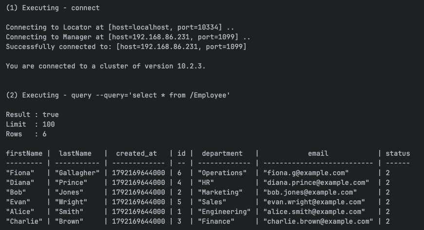

Building Application


See https://gemfire.dev/ja/quickstart/spring


From Root Project directory

```shell
./mvnw package
```

Start GemFire

```start
./deployments/local/gemfire/start.sh
```


## Testing with MySQL 

Start mySQL in Podman

```shell
./deployments/local/mysql/start.sh
```


Create Schema and Table 

```shell
./deployments/local/mysql/setup.sh
```


## Start Application
 
Start with connection to MySQL 

- Note change the spring.datasource properties as needed for Oracle, Postgres, MS SQL, DB2, etc.

```shell
java -jar target/account-gemfire-integration-0.0.1-SNAPSHOT.jar --spring.datasource.driver-class-name=com.mysql.cj.jdbc.Driver --spring.datasource.url="jdbc:mysql://localhost:3306/appdb?allowPublicKeyRetrieval=true&useSSL=false" --spring.datasource.username=root --spring.datasource.password=CHANGEME
```


## Testing/Verification


Execute GemFire query to verify data replicated

```shell
$GEMFIRE_HOME/bin/gfsh -e "connect" -e "query --query='select * from /Employee'"
```



Start MySQL CLI

```shell
podman exec -it mysql mysql -u root -pCHANGEME appdb
```

Insert New in MYSQL

```sql
INSERT INTO company.employees (first_name, last_name, email, department, status) VALUES
    ('Gene', 'Newson', 'gnewson@example.com', 'Artist', 2);
```

Execute GemFire query to verify data replicated

```shell
$GEMFIRE_HOME/bin/gfsh -e "connect" -e "query --query='select * from /Employee'"
```


Update existing record

```sql
update company.employees set last_name = 'Prince-Royal', status = 2 where email =  'diana.prince@example.com';
```


Execute GemFire query to verify data replicated

```shell
$GEMFIRE_HOME/bin/gfsh -e "connect" -e "query --query='select * from /Employee'"
```


## Shutdown 


```shell
$GEMFIRE_HOME/bin/gfsh -e "connect" -e "shutdown --include-locators"
```

Stop MySQL

```shell
podman rm -f mysql
```
