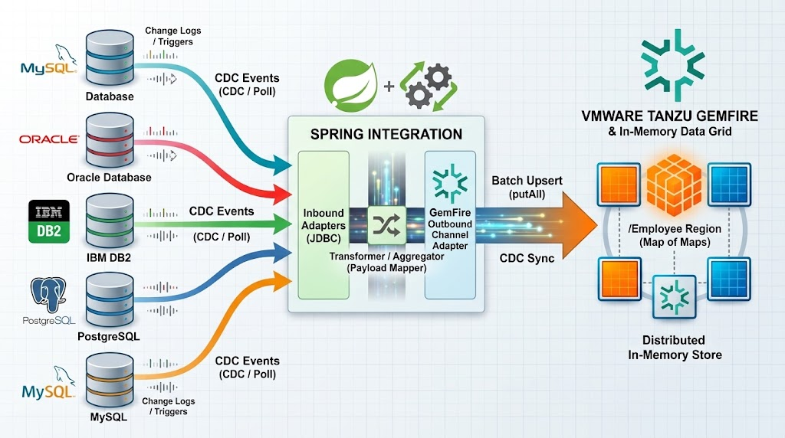
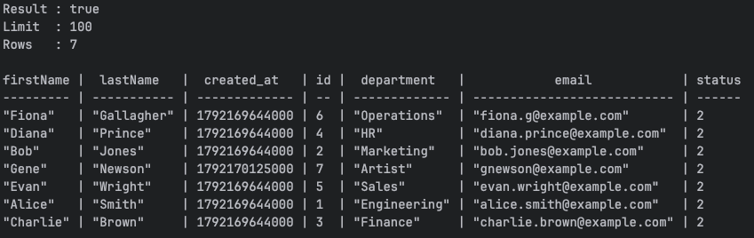
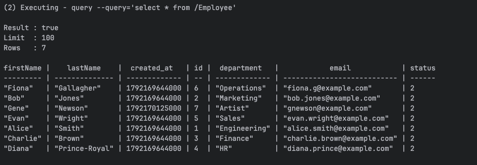

# Spring Integration Gemfire Showcase

This repository demonstrates real-time database replication from SQL databases to [GemFire](http://gemfire.dev) using [Spring Integration](https://spring.io/projects/spring-integration).




Database drivers included

- [MySQL](https://www.mysql.com/)
- [PostgreSQL](https://www.postgresql.org/)
- [IBM DB2](https://www.ibm.com/db2)
- [Oracle Database](https://www.oracle.com/database/)
- [Microsoft SQL Server](https://www.microsoft.com/sql-server)
- [Apache Derby](https://db.apache.org/derby/)
- [MariaDB](https://mariadb.org/)
- [SQLite](https://www.sqlite.org/)


> **Prerequisites & Setup:
- ** See the [GemFire Spring Quickstart Guide](https://gemfire.dev/ja/quickstart/spring) for environment requirements.
- [Podman](https://podman.io/)
- Java 21


## 1. Build the Application

Run the Maven build from the root project directory:

```shell
./mvnw package
```

## 2. Infrastructure Setup

### Start GemFire

Start the local GemFire locator and server instances:

```shell
./deployments/local/gemfire/start.sh
```


### Start MySQL
Start a MySQL instance using Podman:

```shell
./deployments/local/mysql/start.sh
```


### Initialize Database Schema
Create the company schema and employees table:

```shell
./deployments/local/mysql/setup.sh
```


## 3.  Start Application

Run the packaged Spring Boot application configured for MySQL:

```shell
java -jar target/account-gemfire-integration-0.0.1-SNAPSHOT.jar --spring.datasource.driver-class-name=com.mysql.cj.jdbc.Driver --spring.datasource.url="jdbc:mysql://localhost:3306/appdb?allowPublicKeyRetrieval=true&useSSL=false" --spring.datasource.username=root --spring.datasource.password=CHANGEME
```

** Note: Update the spring.datasource properties as needed for other database vendors (e.g., PostgreSQL, Oracle, MS SQL Server, DB2).**

## 4. Testing & Verification

### Step 4.1: Initial Data Check

Verify that initial records from MySQL are automatically polled and replicated to the GemFire */Employee* region:

```shell
$GEMFIRE_HOME/bin/gfsh -e "connect" -e "query --query='select * from /Employee'"
```


### Step 4.2: Insert a New Record
Connect to the MySQL CLI:

```shell
podman exec -it mysql mysql -u root -pCHANGEME appdb
```

Insert a new record with status = 2 (ready for polling):

```sql
INSERT INTO company.employees (first_name, last_name, email, department, status) VALUES
    ('Gene', 'Newson', 'gnewson@example.com', 'Artist', 2);
```

Verify that the new record is replicated to GemFire:

```shell
$GEMFIRE_HOME/bin/gfsh -e "connect" -e "query --query='select * from /Employee'"
```




### Step 4.3: Update an Existing Record
Update an existing record and set status = 2 to trigger re-polling:

```sql
update company.employees set last_name = 'Prince-Royal', status = 2 where email =  'diana.prince@example.com';
```


Verify the updated record in GemFire:

```shell
$GEMFIRE_HOME/bin/gfsh -e "connect" -e "query --query='select * from /Employee'"
```



## 5. Teardown & Cleanup

Stop the GemFire locator and server cluster:


```shell
$GEMFIRE_HOME/bin/gfsh -e "connect" -e "shutdown --include-locators"
```

Stop and remove the MySQL Podman container:

```shell
podman rm -f mysql
```


# Using Debezium versus JDBC Polling

Spring Integration also supports [Debezium](https://docs.spring.io/spring-integration/reference/debezium.html) for Change Data Capture integration.

The following is the logical code to switch to use the Debezium Engine.

```java
@Bean
public IntegrationFlow gemFireDebeziumInboundFlow(
        DebeziumEngine.Builder<ChangeEvent<String, String>> debeziumEngineBuilder,
        CacheWritingMessageHandler cacheWritingMessageHandler) {

    return IntegrationFlow
            .from(Debezium.inboundChannelAdapter(debeziumEngineBuilder))
            .handle(cacheWritingMessageHandler)
            .get();
}
```

### Key Benefits of Using Debezium

* **True Real-Time Streaming:** Captures database changes (inserts, updates, deletes) instantly by reading native transaction logs (e.g., MySQL binlog, Postgres WAL) rather than relying on periodic polling.
* **Zero Schema Pollution:** Eliminates the need for extra database columns like `status` or `updated_at`, triggers, or schema modifications to track state changes.
* **Captures Hard Deletes:** Detects and streams record deletion events seamlessly, which traditional polling mechanisms typically miss.
* **Low Database Overhead:** Minimizes CPU and I/O load on primary databases because it reads transaction log files asynchronously off the main transaction execution path.
* **Includes Before & After States:** Provides the complete state of a row both prior to and after a change event, enabling audit logging and precise downstream state reconciliation.
* **Exact-Once & Order Preservation:** Preserves the exact sequence of database updates and transaction boundaries to guarantee consistency in downstream stores like GemFire or Kafka.
* **Spring Integration Support:** Integrates directly via `Debezium.inboundChannelAdapter()`, allowing you to ingest change events as native Spring Integration messages without complex setup.